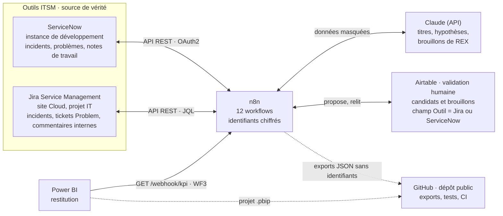
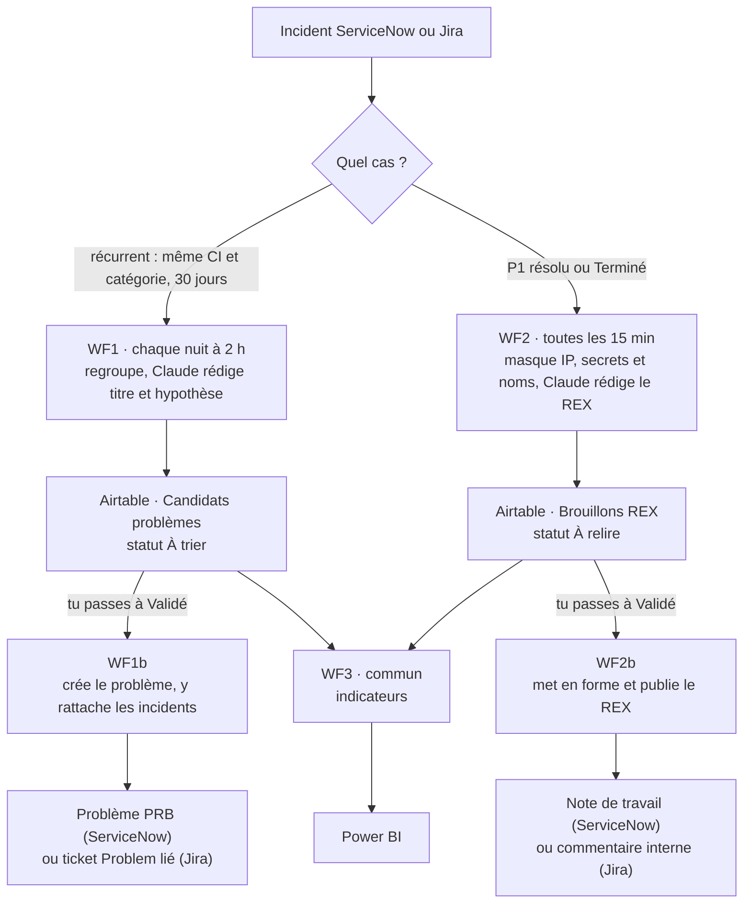

# demo-itsm-servicenow-Jira

[](https://github.com/xavier-manclieres/demo-itsm-servicenow-Jira/actions/workflows/ci.yml)

Détection d'incidents récurrents et rédaction de REX assistée, sur **deux outils ITSM (ServiceNow et Jira Service Management)**, en **infrastructure et workflows as code**.

Chaque nuit, n8n repère dans ServiceNow et dans Jira Service Management les incidents qui se répètent et propose des problèmes à valider. Quand un incident critique (P1) est résolu, il rédige un brouillon de REX à relire. Airtable sert d'espace de validation, Claude de rédacteur, Power BI de restitution.

> Règle de conception : l'outil ITSM reste la source de vérité, et rien n'y est créé sans validation humaine.

## Architecture

n8n orchestre tout. ServiceNow et Jira ne sont modifiés qu'après un « Validé » posé à la main dans Airtable.



Les deux outils partagent le moteur de détection, la base Airtable, les prompts et WF3. Seuls les nœuds qui lisent et écrivent dans l'outil ITSM changent ; le champ « Outil » d'Airtable sépare leurs candidats et leurs brouillons.

### Cheminement d'un incident



Un brouillon ou un candidat qui n'est pas validé reste dans Airtable : rien ne part vers l'outil ITSM.

## Workflows

| Workflow | Rôle | Déclencheur | ServiceNow | Jira Service Management |
|---|---|---|---|---|
| WF0 | Jeu de données : 3 CI et 22 incidents de démo | manuel, une fois | [`servicenow-wf0`](servicenow/workflows/servicenow-wf0-jeu-de-donnees.json) | [`jira-wf0`](jira/workflows/jira-wf0-jeu-de-donnees.json) (CI = composants) |
| WF0b | Un incident P1 commenté puis terminé, pour tester WF2 | manuel | à la main dans l'instance | [`jira-wf0b`](jira/workflows/jira-wf0b-incident-p1.json) |
| WF1 | Détection des incidents récurrents, candidats dans Airtable | chaque nuit à 2 h | [`servicenow-wf1`](servicenow/workflows/servicenow-wf1-incidents-recurrents.json) | [`jira-wf1`](jira/workflows/jira-wf1-incidents-recurrents.json) |
| WF1b | Création du problème et rattachement des incidents | candidat passé à « Validé » (vérifié toutes les 5 min) | [`servicenow-wf1b`](servicenow/workflows/servicenow-wf1b-creation-probleme.json) | [`jira-wf1b`](jira/workflows/jira-wf1b-creation-probleme.json) |
| WF2 | Brouillon de REX rédigé par Claude | P1 résolu (vérifié toutes les 15 min) | [`servicenow-wf2`](servicenow/workflows/servicenow-wf2-brouillon-rex.json) | [`jira-wf2`](jira/workflows/jira-wf2-brouillon-rex.json) |
| WF2b | Publication du REX validé dans l'incident | brouillon passé à « Validé » (vérifié toutes les 5 min) | [`servicenow-wf2b`](servicenow/workflows/servicenow-wf2b-publication-rex.json), note de travail HTML | [`jira-wf2b`](jira/workflows/jira-wf2b-publication-rex.json), commentaire interne ADF |
| WF3 | Indicateurs pour Power BI | actualisation du rapport (GET /webhook/kpi) | [`wf3-indicateurs`](workflows/wf3-indicateurs.json), commun aux deux outils | |

Tous sont construits et testés, c'est-à-dire exécutés sur une instance ServiceNow de développement et sur un site Jira Service Management Cloud, avec des données fictives. Dans n8n, ils s'appellent « Démo ITSM ServiceNow — … » ou « Démo ITSM Jira — … », pour ne jamais confondre les deux.

Les particularités de Jira (format ADF, liens Problem/Incident, date de passage à « Terminé ») et la correspondance avec ServiceNow sont détaillées dans [`jira/README.md`](jira/README.md).

## Ce que le DevOps apporte

- **Infra as code** : n8n et Postgres démarrent avec `docker compose up`.
- **Deux outils ITSM, une seule base** : Jira et ServiceNow partagent les tables Airtable ; le champ « Outil » sépare leurs candidats et leurs brouillons, chaque workflow ne voit que les siens.
- **Workflows as code** : exports JSON sans identifiants, relus par diff. Un dossier par outil ITSM (`servicenow/workflows/`, `jira/workflows/`) et `workflows/` pour ce qui ne dépend d'aucun outil (WF3).
- **Prompts versionnés** : `prompts/`, chaque changement est un commit.
- **Tests** : 77 tests dans `code-nodes/` exécutent le code des nœuds Code **directement depuis les exports** de workflows, pour les deux outils. Le code testé est exactement celui qui tourne dans n8n, sans copie à maintenir.
- **CI** : validation du JSON, tests et recherche de secrets à chaque push.

## Démarrage

Prérequis : Docker, Node.js 22 ou plus, Git.

```bash
cp .env.example .env        # puis renseigner les valeurs
docker compose -f infra/docker-compose.yml --env-file .env up -d
```

n8n est ensuite disponible sur http://localhost:5678.

```bash
npm test                    # tests des nœuds Code (77)
npm run validate:json       # exports valides et sans identifiant
```

### Importer les workflows

Dans n8n : *Workflows › Import from File*, puis choisir les fichiers de `servicenow/workflows/`, de `jira/workflows/`, ou des deux, et `workflows/wf3-indicateurs.json`. Ensuite :

1. Créer les identifiants et les associer aux nœuds :
   - **ServiceNow** : OAuth2, application « n8n » dans System OAuth → Application Registry, redirection vers `…/rest/oauth2-credential/callback`. La Basic Auth est bloquée par défaut sur les instances récentes (« Basic Auth Restriction »).
   - **Jira** : identifiant « Jira Software Cloud API » avec un jeton d'API personnel, puis remplacer `votre-site.atlassian.net` par l'adresse de votre site dans les nœuds HTTP (prérequis dans [`jira/README.md`](jira/README.md)).
   - **Airtable** (jeton d'accès), **Anthropic** et, pour WF3, un identifiant **Basic Auth** dédié à Power BI.
2. Remplacer l'identifiant de base Airtable (`app…`) et de table (`tbl…`) par ceux de votre base, construite selon `airtable/schema.md`.
3. Lancer WF0 de l'outil choisi : il crée les trois CI de la démo s'ils manquent (composants dans Jira), puis 22 incidents. Côté Jira, WF0b crée un incident P1 terminé pour tester WF2.

### Brancher Power BI

WF3 renvoie un JSON en trois parties : `synthese` (une ligne d'indicateurs), `problemes` et `rex` (une ligne par enregistrement). Le guide pas à pas (requêtes Power Query, mesures DAX, mise en page) est dans [`powerbi/README.md`](powerbi/README.md).


Le rapport se construit d'abord sur `powerbi/exemple-kpi.json`, une réponse de WF3 sur données fictives, produite par le vrai code du nœud (un test vérifie qu'elle reste à jour). On bascule ensuite sur l'adresse de WF3 en changeant une seule ligne.

| Indicateur | Calcul |
|---|---|
| Taux de validation | validés (y compris créés) / (validés + rejetés) |
| Incidents regroupés | somme des incidents de tous les candidats |
| Délai de relecture | de la création du brouillon à sa publication, en heures |
| MTTR P1 | moyenne des durées ouverture → résolution des P1, en minutes |

## Arborescence

```
servicenow/    workflows WF0 à WF2b ServiceNow, Business Rule, jeu de données
jira/          workflows WF0 à WF2b Jira Service Management (+ WF0b), guide du connecteur
workflows/     exports communs aux deux outils (WF3, indicateurs)
code-nodes/    JavaScript des nœuds Code + tests
prompts/       prompts du tri et du REX
airtable/      schéma des tables
powerbi/       données d'exemple, guide et projet du rapport
scripts/       validation des exports, génération de l'exemple Power BI
infra/         docker-compose, déploiement
.github/       CI
```

## Sécurité

- Aucun secret dans le dépôt : `.env` est ignoré, seul `.env.example` est versionné.
- Les exports de workflows ne contiennent aucun identifiant, ni l'adresse réelle du site Jira (vérifié par la CI).
- Avant tout envoi à Claude, WF2 (ServiceNow et Jira) masque les adresses IP et les secrets passés en clair, et remplace les noms des intervenants par « Intervenant 1, 2… ». Des tests vérifient qu'aucune de ces données ne fuit.
- WF3 n'expose que des comptes, des durées et des statuts : ni texte de REX, ni hypothèse, ni sys_id. Son adresse est protégée par un identifiant Basic Auth que Power BI garde dans son coffre : il n'apparaît jamais dans le code du rapport versionné. Un test vérifie l'absence de fuite.
- Toutes les données de démo sont fictives.

## Feuille de route

- [x] Semaines 1-2 : dépôt, CI, base Airtable, WF0
- [x] Semaines 3-4 : WF1 et WF1b, tests sur le code réel des nœuds
- [x] Semaines 5-6 : WF2, WF2b et WF3
- [x] Rapport Power BI (projet `.pbip` versionné, construit sur données fictives)
- [x] Instance ServiceNow de développement, connexion OAuth2
- [x] Second outil ITSM : Jira Service Management, sur la même base Airtable
- [ ] Webhook ServiceNow (Business Rule) à la place du sondage de WF2
- [ ] Déploiement Ansible, post LinkedIn

## Licence

MIT
